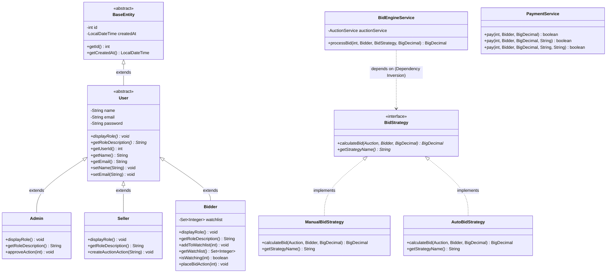

# Day 5 UML Class Diagram: Inheritance, Polymorphism & Interfaces

This document outlines the Object-Oriented design relationships implemented in the **Online Auction System** for Day 5.

## 1. Class & Interface Diagram (Mermaid)

## 2. Diagram Breakdown

1. **`BaseEntity` & `User` (Inheritance & Common State)**
   - `BaseEntity` is an abstract class holding common identity (`id`) and audit timestamp (`createdAt`).
   - `User` extends `BaseEntity`, reusing identity state while adding core user credentials (`name`, `email`, `password`).
   - `Admin`, `Seller`, and `Bidder` inherit all common attributes without repeating fields, invoking `super()` constructors.

2. **`BidStrategy` (Interface & Strategy Pattern)**
   - Defines a uniform contract (`calculateBid`) for placing bids.
   - `ManualBidStrategy` processes direct manual bids meeting minimum increment rules.
   - `AutoBidStrategy` processes proxy/automated increments up to a defined budget ceiling.
   - `BidEngineService` consumes `BidStrategy` polymorphically at runtime without depending on concrete classes.

3. **`PaymentService` (Method Overloading)**
   - Illustrates compile-time polymorphism where three overloaded `pay(...)` methods share the same name but provide distinct parameter signatures for wallet, custom payment modes, and promotional vouchers.
